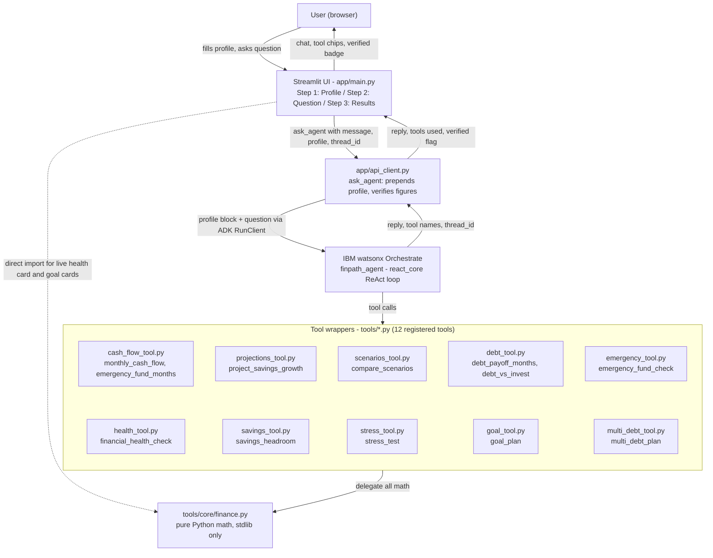

# FinPath AI — Architecture

## System diagram (Mermaid)



## System overview

```
┌─────────────────────────────────────────────────────────┐
│                    User (browser)                        │
└─────────────────────┬───────────────────────────────────┘
                      │ HTTP
┌─────────────────────▼───────────────────────────────────┐
│              Streamlit UI  (app/main.py)                 │
│                                                          │
│  Step 1: Profile  ──►  live health card (local math)    │
│  Step 2: Question ──►  suggestion chips                  │
│  Step 3: Results  ──►  multi-turn chat                   │
└─────────────────────┬───────────────────────────────────┘
                      │ ask_agent(message, profile)
┌─────────────────────▼───────────────────────────────────┐
│          api_client.py  (thin ADK wrapper)               │
│                                                          │
│  • Prepends full profile to every message                │
│  • Prints message to terminal (no secrets)               │
│  • Calls RunClient.create_run()                          │
│  • Waits for completion, extracts reply + tool names     │
└─────────────────────┬───────────────────────────────────┘
                      │ MCSP token (from ~/.wxo/)
┌─────────────────────▼───────────────────────────────────┐
│         IBM watsonx Orchestrate                          │
│                                                          │
│  Agent: finpath_agent (groq/openai/gpt-oss-120b)         │
│  Style: react_core (ReAct loop)                          │
│                                                          │
│  Rules:                                                  │
│  • Use a tool for EVERY number — never self-compute      │
│  • Quote tool summary fields verbatim                    │
│  • Multi-turn: compare new vs previous answer            │
│  • Close every reply: "not financial advice"             │
└─────────┬──────────────────────┬───────────────────────┘
          │ tool calls           │ tool results
┌─────────▼──────────┐  ┌───────▼──────────────────────┐
│  @tool wrappers     │  │  tools/core/finance.py        │
│  tools/*.py         │  │  (pure Python, stdlib only)   │
│                     │  │                               │
│  financial_health.. │  │  10 pure functions:           │
│  monthly_cash_flow  │  │  • monthly_cash_flow          │
│  project_savings..  │  │  • project_savings_growth     │
│  compare_scenarios  │  │  • compare_scenarios          │
│  emergency_fund_..  │  │  • emergency_fund_months      │
│  debt_payoff_months │  │  • emergency_fund_check       │
│  debt_vs_invest     │  │  • debt_payoff_months         │
│  stress_test        │  │  • debt_vs_invest             │
│  savings_headroom   │  │  • stress_test                │
│  emergency_fund_chk │  │  • savings_headroom           │
│  goal_plan          │  │  • financial_health_check     │
│  multi_debt_plan    │  │  • goal_plan          [NEW]   │
└─────────────────────┘  │  • debt_schedule      [NEW]   │
                         │  • savings_schedule   [NEW]   │
                         │  • multi_debt_plan    [NEW]   │
                         └───────────────────────────────┘
```

## Design principles

1. **Pure math in `tools/core/finance.py`** — zero ADK imports, stdlib only. Every function is unit-testable without credentials.

2. **Thin `@tool` wrappers** — no logic in `tools/*.py`. They only call `core.finance.*` and let the ADK handle schema generation.

3. **Agent never computes numbers** — every figure in the reply must come from a tool call. The agent YAML instructions enforce this explicitly.

4. **Profile in every message** — `api_client._build_message` prepends the full profile block to every single message, including follow-ups. The agent always has all inputs.

5. **Thread continuity** — `thread_id` is stored in `st.session_state` and passed on every follow-up call. Orchestrate maintains conversation context server-side.

6. **Local health card** — `financial_health_check` is called directly in `app/main.py` (no agent call) to render the live score card on Step 1. Fast, free, instant.

## Data flow for a typical question

```
User: "How long to pay off my debt?"
  │
  ▼
main.py: _send_message("How long to pay off my debt?")
  │
  ▼
api_client._build_message() prepends:
  "User profile: monthly_income=$3,200; debt_balance=$8,000;
   annual_debt_rate=7.00% (0.0700); monthly_debt_payment=$250; ..."
  │
  ▼
RunClient.create_run(full_message, agent_id, thread_id=None)
  │
  ▼
Orchestrate agent (ReAct loop):
  thinks → calls debt_payoff_months(balance=8000, rate=0.07, payment=250)
  tool returns: {months_to_payoff: 36, total_interest_paid: 880.88, summary: "..."}
  agent quotes summary → generates reply
  │
  ▼
api_client returns: {reply: "...", tools: ["debt_payoff_months"], thread_id: "abc123"}
  │
  ▼
main.py: appends to S.messages, renders with st.chat_message("assistant")
         shows tool chip: ⚙ debt_payoff_months
```

## Auth

The ADK (`orchestrate` CLI) stores a short-lived MCSP token in `~/.wxo/`. Refresh with:
```bash
orchestrate env activate finpath --api-key "YOUR_KEY"
```
No secrets are stored in `.env` for the UI path. The `.env` / `.env.example` are provided for reference only.

## Tool reference


| Tool | Wrapper file | What it calculates |
|---|---|---|
| monthly_cash_flow | cash_flow_tool.py | Net monthly surplus: income − expenses − debt payments − savings contribution |
| emergency_fund_months | cash_flow_tool.py | How many months of expenses current savings covers |
| project_savings_growth | projections_tool.py | Future savings value via monthly compound interest over a chosen horizon |
| compare_scenarios | scenarios_tool.py | Side-by-side comparison of 1–3 scenarios: cash flow, emergency months, projected savings |
| debt_payoff_months | debt_tool.py | Months to full payoff and total interest for a single fixed-rate debt |
| debt_vs_invest | debt_tool.py | Net worth at end of horizon: "pay debt first" vs "invest immediately" |
| emergency_fund_check | emergency_tool.py | Status (low / ok / strong), months covered, gap to the 3-month guideline |
| financial_health_check | health_tool.py | Composite 0–100 score with four sub-scores and ordered priorities |
| savings_headroom | savings_tool.py | Maximum extra monthly savings capacity after expenses and current contributions |
| stress_test | stress_tool.py | Re-runs cash flow and emergency coverage after an income or expense % shock |
| goal_plan | goal_tool.py | Whether a savings target is reachable in N months, and the required monthly contribution |
| multi_debt_plan | multi_debt_tool.py | Avalanche vs snowball payoff for multiple debts; picks the lower-interest strategy |

## Guardrails

The following rules are set in [`agents/finpath_agent.yaml`](../agents/finpath_agent.yaml) and applied on every response.

### Numbers must come from tools

The agent must **never compute, estimate, or round any figure itself**. Every number in a response must come directly from a tool call. When a tool returns a `summary` field, the agent reproduces it **word-for-word** before adding plain-language context.

### All assumptions must be stated

Every response containing numbers must list the exact inputs used: income, expenses, debt balance, interest rate, payment amounts, projection horizon, and growth rate. The four defaults that must be declared when applied:

- **Annual savings growth rate:** 5% p.a. (when the user does not specify)
- **Projection horizon:** 12 months (when the user does not specify)
- **Emergency fund target:** 3–6 months of essential expenses (guideline only)
- **Assumed investment rate for `debt_vs_invest`:** 7% p.a. (when not specified); the agent flags debt-first if the debt rate exceeds this

### Profile context

The debt rate is supplied in both percentage and decimal in every message by `api_client._build_message()` so the agent passes the correct decimal form to tools without conversion. The agent only asks a clarifying question if a required value is **explicitly missing or zero** — it never assumes a value.

### Multi-turn continuity
Follow-up questions (e.g. "what if I paid $100 more a month?") are handled by calling the relevant tool again with the changed inputs and explicitly comparing the new result with the previous answer. Both the old and the new number must appear in the reply.

### Debt-first flag

After calling `debt_vs_invest`, if `annual_debt_rate > assumed_invest_rate`, the agent proactively highlights this and recommends considering the debt-payoff-first strategy before investing.

### No product recommendations

The agent must never recommend specific financial products, securities, mutual funds, ETFs, or any buy/sell action. `compare_scenarios` and `debt_vs_invest` are presented as illustrative comparisons only.

### Mandatory disclaimer

Every response closes with the exact sentence:

> "This is educational information, not financial advice."

This is reinforced in the Streamlit UI with the persistent banner: *"Educational tool · Not financial advice · All projections are illustrative only."*

### Figure verification

`api_client._verify_figures()` cross-checks every dollar amount and percentage in the agent reply against the raw tool outputs (±$0.51 rounding tolerance) after every turn. The result is surfaced in the UI as a verified badge.
